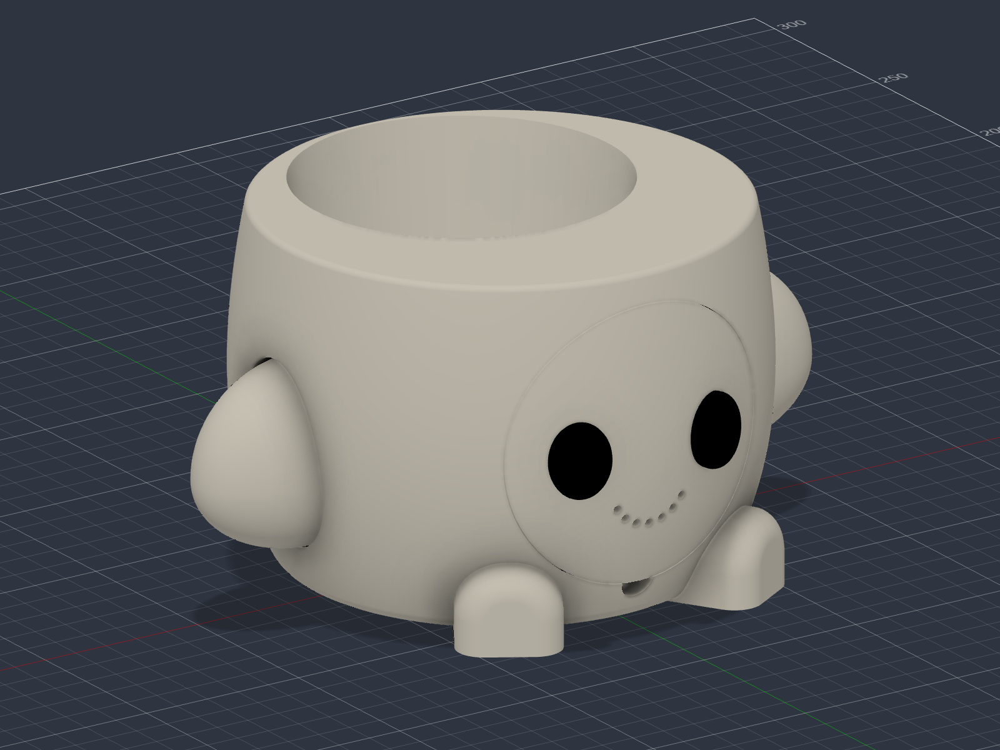
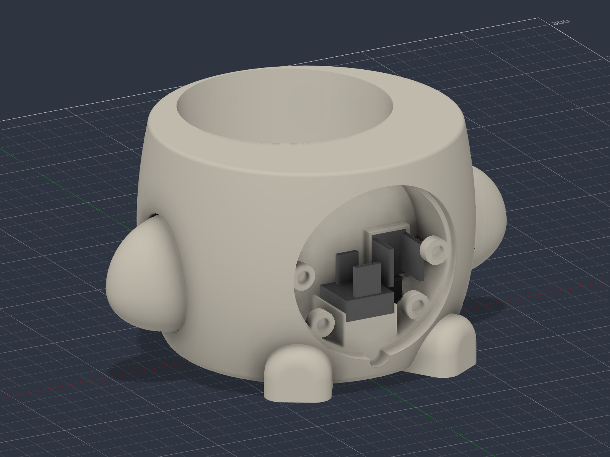

# ふたまる 筐体（鉢植え型・まんまるキャラ）

3号のプラ鉢（上の直径 約90mm）を上から落とし込む、樽のようにふくらんだ鉢カバーです。
顔は、黒く刷って貼る楕円の立体の目 2 つと、にっこりした弧にならべた 7 つの穴の口だけです。口の穴の奥にはスピーカーの面が当たっていて、音の出口を兼ねます。
顔のまわりは本体と同じ曲面を丸く切り出した「顔のふた」で、はめると細い円の継ぎ目しか見えません。
ふたは磁石で付くので、表からネジは見えません。ふたには電子部品を付けないので、外しても線はつながっていません。
腕は下がふっくらした卵形、足は正面から見てアーチ形の背の高い足です。どちらも付け替えられます（らしさのカスタマイズ用）。
給電は USB-C のケーブル 1 本です。ケーブルは本体の底の溝を通って背面から出ます。

目・腕・足・口の形は、チャムさんのデザイン案（futamaru_3d_v2）を参考にしました。
ディスプレイは実装の手間を考えて今回は付けません（2026-11-16 にチームで決定）。表情は立体の目で固定で、ふたまるは話すことに集中します。
電子部品は、パーツ選定で決めた **XIAO ESP32S3（Sense なし）と M5Stack Atomic Voice Base** の 2 つです（2026-11-16）。

| ファイル | 中身 |
|---|---|
| `futamaru_pot/futamaru_pot.py` | Fusion のスクリプト。実行すると新しいドキュメントに筐体一式を作る |
| `out/*.stl` | 印刷用の STL（本体・顔のふた・目・腕・足） |
| `out/futamaru_pot.f3d` | Fusion のデータ（タイムラインとパラメータ付き） |
| `out/view_*.png` | 確認用の画像。`view_inside_*` は顔のふたを外した状態（灰色は参照部品）、`view_bottom` は底の溝 |
| `out/build_log.txt` | 最後に作ったときのログ（各手順の成否・ふたの厚さ・外形寸法・干渉チェック） |

## 作り直し方

- **Fusion の画面から**: Shift+S →［スクリプト］の［+］で `futamaru_pot` フォルダを追加 → 選んで［実行］
- **Claude などから Fusion MCP で**: スクリプトの中身を `fusion_mcp_execute`（`featureType: "script"`）に渡す。
  先頭の `from __future__ import annotations` は外して渡す（MCP 側でスクリプトが包まれるため）。
  このときは書き出し先がスクリプトの `_DEFAULT_OUT`（`~/Desktop/Lit/team4/hardware/enclosure/out`）になるので、別の場所で作業しているときは書き換えて渡す

実行するたびに新しいドキュメントができます（前のものは閉じません。いらなければ保存せずに閉じてください）。
終わってもダイアログは出ません。結果（失敗の数とログの場所）は［テキスト コマンド］欄と `out/build_log.txt` に出ます。

寸法は「ユーザー パラメータ」に入っています。［修正］→［パラメータを変更］で数字を直すと形が追随します。
ただし顔のふたの曲面、腕・足と、それをはめるくぼみや穴は実行時に本体の形から作るので、本体の形や `arm_*`・`foot_*`・`peg_*` を変えたときはスクリプトを実行し直してください。
足の角度（`FOOT_ANGLE`）、腕のピンの高さ（`ARM_PEGS_DZ`）、磁石の位置（`MAG_POINTS`）、口の穴の数（`MOUTH_HOLES`）、画像に付ける色（`BODY_RGB`・`EYE_RGB`）はスクリプトの先頭の定数です。

よく触りそうなパラメータ:

| 名前 | 値 | 意味 |
|---|---|---|
| `body_h` | 104 | 本体の高さ。幅（約 149mm）との比をチャムさんの案（約 1.4）に合わせている |
| `r_bot` / `r_low` / `r_belly` / `r_sh` / `r_top` | 61 / 70 / 75 / 73.5 / 70 | 本体のふくらみ（下から上へ5点の半径）。いちばん太いところ（`z_belly` 50）は高さのほぼ真ん中。`r_top` は鉢の穴の後ろの壁の厚さで決まるので、これより小さくできない |
| `pot_top_d` / `pot_bot_d` | 96 / 74 | 鉢の穴の上と底の直径。手持ちの鉢に合わせる |
| `plate_d` / `plate_gap` | 82 / 0.2 | 顔のふたの直径と、本体の穴とのすき間（片側）。きつい・ゆるいはここで調整 |
| `eye_x` / `eye_dz` | 22 / -3 | 目の位置（顔の中心から横、`comp_zc` から縦） |
| `eye_w` / `eye_h` / `eye_t` | 18 / 22 / 5.5 | 目の幅・高さ・厚さ |
| `mouth_w` / `mouth_drop` / `mouth_dz` | 21 / 6 / -19.3 | 口の幅（両端の穴の中心どうし）、両端からいちばん下までの深さ、両端の高さ。穴がみな Voice Base の前に来るよう、幅は 21 までにする |
| `mouth_hole_d` | 2.4 | 口の穴の直径。太くすると奥の部品が見えやすくなる |
| `vb_z0` | -28 | Voice Base の底の高さ（`comp_zc` から）。スピーカーの面が口の穴の奥に来る高さ |
| `xiao_cx` / `xiao_z0` | 22.5 / -20 | XIAO の中心の横の位置と、下の端（USB の口）の高さ |
| `xiao_standoff` | 3 | 奥の壁から XIAO の部品の面まで。部品とアンテナのコネクタが当たらない高さ |
| `plug_w` / `plug_t` / `plug_len` | 12.5 / 7.5 / 20 | 想定する USB-C のプラグの根元（太いところ）の大きさ。これより大きいケーブルは通らない |
| `groove_w` / `groove_h` | 7 / 7 | 底の溝の幅と深さ。太いケーブルを使うなら広げる |
| `arm_r` / `arm_top` / `arm_bot` / `arm_out` | 19 / 32 / 23 / 34 | 腕の卵形（前後の半径、いちばん太いところから上・下の端まで、外への出っ張り） |
| `arm_z` / `arm_x0` | 40 / 66 | 腕のいちばん太いところの高さと、取り付け面の位置（本体の中心から） |
| `foot_w` / `foot_h` / `foot_out` | 30 / 24 / 14 | 足の幅・高さ・前への出っ張り。`foot_h` を上げると、正面から見て顔のふたにかかる |
| `peg_hole_d` | 6.3 | 腕・足の差し込み穴。きつい・ゆるいはここで調整 |

## 部品

| 部品 | 型番 | 数 | 備考 |
|---|---|---|---|
| マイコン | Seeed Studio XIAO ESP32S3（Sense ではない方、113991114） | 1 | 付属のアンテナも使う。ピンヘッダをはんだ付けしておく |
| 音声 | M5Stack Atomic Voice Base（A149。旧名 Atomic Echo Base） | 1 | スピーカー・マイク・アンプ（ES8311）入り。24 × 24 × 10mm |
| ジャンパー線 | メス-メス、10〜15cm | 8 本 | XIAO と Voice Base をつなぐ |
| USB-C ケーブル | データ通信できるもの。プラグの根元が 12.5 × 7.5mm 以内、長さ 20mm 以内 | 1 | 給電と書き込みの両方に使う。L 字（上下 L 字）のものでもよい |
| 両面テープ | クッション入り、厚さ 1〜2mm | 少し | XIAO と Voice Base を貼る |
| 磁石 | ネオジム磁石 Φ6×3 | 8 | 顔のふたと本体に 4 個ずつ。向き（極）をそろえて接着 |

配線（パーツ選定で決めたもの）:

| Voice Base | XIAO |
|---|---|
| SDA / SCL | D4 / D5 |
| SCLK / LRCK | D0 / D1 |
| DSDIN / ASDOUT | D2 / D3 |
| 5V / GND | 5V / GND |

## 部屋の中の配置

顔のふたを外すと、直径 78mm・奥行き 28mm の丸い部屋があります（`out/view_inside_front.png`）。

- **Voice Base**: 口の真後ろ。スピーカーのスリットがある側面を前（ふたの裏）に、ピンを上に向けて、部屋の底から立てた台に載せる。
  左右の縁と後ろの止めで位置が決まり、前はふたが押さえる（ふたとのすき間 0.2mm）。
  マイクの穴（MIC と書かれた面の上の切り欠き）は横を向く。外の音は、口の穴から音の部屋のはみ出したところを通って届く
- **XIAO**: 部屋の右。奥の壁から出た枠に差し込む。部品の面を奥の壁に、ピンを前に向ける（ピンヘッダをふつうに付けた向き）。USB は下向き
- **USB-C ケーブル**: XIAO の真下に、本体の底まで抜けた縦の穴（14 × 10mm）がある。プラグを底から差し込んで XIAO に挿し、ケーブルは底の溝（7 × 7mm）に沿わせて背面へ出す

## 組み立て

1. 磁石を本体と顔のふたの穴に接着する（くっつく向きを確かめてから）。目を顔のふたの楕円の座面に接着する
2. XIAO にピンヘッダをはんだ付けし、アンテナを U.FL のコネクタに挿す。ジャンパー線 8 本で Voice Base とつなぐ（上の表）
3. Voice Base を、スピーカーの面を前にして部屋の台に載せ、後ろの止めに当たるまで押し込む。台に両面テープを貼っておくと動かない
4. XIAO の部品の面（シールドの上）に両面テープを貼り、部屋の右の枠に正面から差し込んで奥の壁に貼る（USB は下）
5. アンテナは部屋の天井の内側に貼る（XIAO や線から離す）
6. 本体を横に倒し、USB-C のプラグを底の縦の穴から差し込んで XIAO に挿す。ケーブルは底の溝に押し込んで背面へ出す
7. ジャンパー線を部屋の奥や上へ寄せる（ふたの裏より前に出ないように）。顔のふたを丸い穴にはめる。外すときはあごの下の指かけに指をかける
8. 腕を側面の卵形のくぼみにはめる（ピン 2 本）。足を差し込む。植物はプラ鉢のまま上から入れる

書き込みも同じケーブルでできます（パソコンにつなぎ替える）。
書き込めなくなったとき（BOOT ボタンを押しながらつなぐとき）は、ふたを外して XIAO を枠から引き出します。ボタンは部品の面（奥の壁の側）にあります。

## 印刷（Bambu Lab A1 mini を想定。造形範囲 180mm 角に全部収まる）

| 部品 | 向き | サポート |
|---|---|---|
| 本体 | 底を下 | 顔の部屋の天井に必要。ビルドプレートからのサポートにする。XIAO の枠の天井と底の溝の天井はブリッジで刷れる |
| 顔のふた | 平らな背面を下（曲面の表を上） | 不要の見込み（口の奥の音の部屋の天井は、幅 11mm のブリッジになる） |
| 目（2 個） | 平らな面を下。黒で刷る | 不要 |
| 足 | 底を下 | 不要 |
| 腕 | 平らな取り付け面を下 | 不要 |

本体は中が詰まった形（約 960cm³）なので、インフィルは少なめ（ジャイロイド 8〜10%）にしてください。
本体・顔のふた・腕・足を白か生成り、目を黒で刷れば、塗らずにチャムさんの案の色になります（`out/view_*.png` もこの色で写しています）。

## 確認したこと（2026-11-16）

- 全部の手順がエラーなく通る（`out/build_log.txt`）
- 部品の外形を組み立てたときの位置に置いて、干渉チェックをした。本体・顔のふた・目・腕・足と、どれもぶつからない（0 件）
  - 置いたもの: Voice Base、XIAO の基板・シールド・USB の受け口、両方のピンに挿したジャンパー線のコネクタ（長さ 14mm）、USB-C のプラグの根元（12.5 × 7.5 × 20mm）、ケーブル（Φ4.5）
  - USB-C のプラグを底から通す縦の穴は 14 × 10mm で、プラグより片側 0.75mm 以上広い
- XIAO のジャンパー線のコネクタの先から顔のふたの裏まで 7.3mm あり、線を曲げる場所がある
- 口の穴は 7 個（Φ2.4、すき間 1.8mm）。どの穴も奥が Voice Base の前面（黒）になり、中の基板は見えない
- 口の奥の音の部屋の前に残るふたの厚さ: 最小 2.29mm
- Voice Base のスリットとマイクの穴の位置は、M5Stack の公式ページの図面と写真で確かめた
- 腕のくぼみは、腕のいちばん太い高さで本体の表面から 8.2mm の深さ
- 足（高さ 24mm）は、正面から見て顔のふたの円にかからない

## まだやること

- **印刷して嵌め合いを確かめる**: 顔のふた・差し込みピン・腕のくぼみ・Voice Base の台と XIAO の枠のきつさ、磁石の強さ
- **手持ちの USB-C ケーブルが通るか確かめる**: プラグの根元が `plug_w` × `plug_t` より大きい、または `plug_len` より長いときは、パラメータを直して作り直す
- **Voice Base のピンの列の位置を実物で確かめる**: 公式の図面に寸法がないので、上の面の前後のふちから 3mm と置いている（`VB_PIN_INSET`）
- **音を確かめる**: マイクは部屋の中にあり、口の穴の奥から音を拾う。声が小さく入るなら、音の部屋を広げるかマイクの向きを口の側へ変える
- **印刷量を減らす**: 本体は約 960cm³ と重い。中をくり抜くか、背を戻すかをチームで決める
- **チャムさんと形を詰める**: 目の位置（`eye_x`・`eye_dz`）と、口との間の広さ

## 使った外部の技術・素材

| 名前 | 使い方 | リポジトリに含めるか |
|---|---|---|
| Autodesk Fusion（教育機関ライセンス）と Fusion API | モデリング・干渉チェック・書き出し | — |
| Autodesk Fusion MCP サーバー | Claude Code からスクリプトを実行 | — |
| M5Stack Atomic Voice Base の公式ドキュメント（図面・写真） | Voice Base の外形、スピーカーとマイクの穴の位置 | 含めない |
| Seeed Studio XIAO ESP32S3 の公式の寸法 | XIAO の基板と USB の受け口の大きさ | 含めない |
| チャムさん（チーム）のデザイン案 futamaru_3d_v2 | 目・腕・足・口の形と、底の溝からケーブルを出す方法の参考 | 含めない |
| Claude Code（生成 AI） | 鉢植え型のスクリプト作成と Fusion での実行 | — |

参照部品（Voice Base・XIAO・コネクタ・ケーブル）は、スクリプトの中で箱として作っています。メーカーの 3D データは使っていません。
